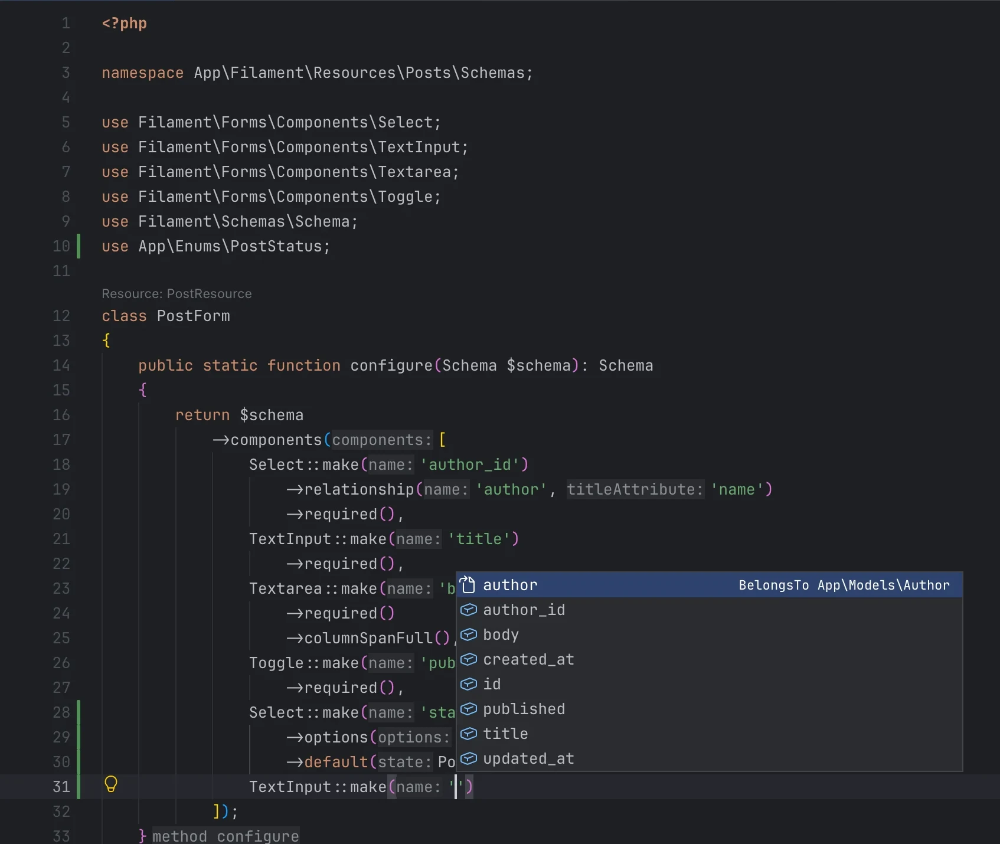

<h1 align="center">Tusk</h1>

  The PHP editor for Laravel artisans. 
  <a href="https://tusk.almontasser.ly">Website</a> ·
  <a href="https://github.com/almontasser/tusk/releases/latest">Download</a> ·
  <a href="docs/README.md">Documentation</a>

Tusk is a fast desktop editor for PHP, Laravel, and Filament projects on
macOS, Windows, and Linux. It aims for PhpStorm-class navigation and
refactoring using only free, open-source language servers. Its name comes from
PHP's elePHPant.

Tusk is in alpha. Try it on your app, and
[open an issue](https://github.com/almontasser/tusk/issues) to say what works
and what doesn't.

## Features

- **Laravel and Filament intelligence.** Completion and ⌘-click work on
  routes, views, config keys, and model columns. Tusk's own PHP language
  server is written in Rust and indexes a 23,000-file app in about a second.
- **Visual designers.** Design Filament resources, models, enums, navigation,
  notifications, and more. Each change is a small edit to your own files.
- **Refactoring.** Rename, extract, inline, change signature, safe delete,
  and move class.
- **Static analysis.** Mago and your project's Larastan check as you type.
- **Built-in tools.** An HTTP client that reads your routes, a database
  client, an Xdebug debugger, a profiler, a test runner, Git with GitHub pull
  requests, Composer, and SFTP deployment.
- **Local AI completion.** Qwen2.5-Coder runs on your GPU, so your code never
  leaves your computer.
- **Fast.** Typing stays at about 3 ms of work per keystroke, even in a
  4,800-line file, and language servers never block the window.

## Install

Download the app for your system from the
[latest release](https://github.com/almontasser/tusk/releases/latest). You
need PHP 8.1 or later and Git; Node.js adds Tailwind CSS, TypeScript, and Vue
support. Tusk downloads and manages its other tools itself. For details, see
[Getting started](docs/getting-started.md).

## Documentation

- [User guide](docs/README.md): every feature, from the window and shortcuts
  to the designers, debugger, and deployment
- [Known gaps](docs/known-gaps.md): what's missing or limited compared with
  PhpStorm
- [Development](docs/development.md): build, test, and release Tusk
- [Architecture and decisions](docs/architecture.md)

## License

Tusk is licensed under the [Functional Source License, Version 1.1, MIT Future License](LICENSE.md) (FSL-1.1-MIT). You can use, change, and share Tusk for any purpose except offering it, or something built from it, as a competing commercial product. Two years after each version is released, that version also becomes available under the MIT license.
